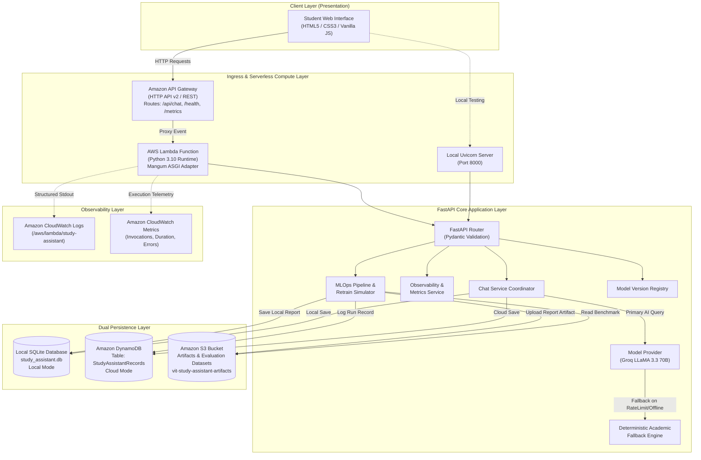
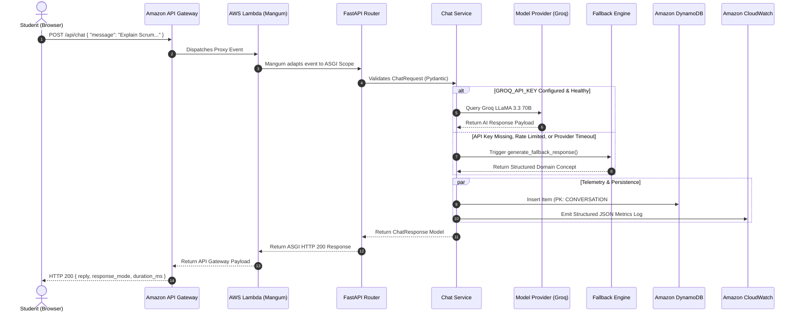
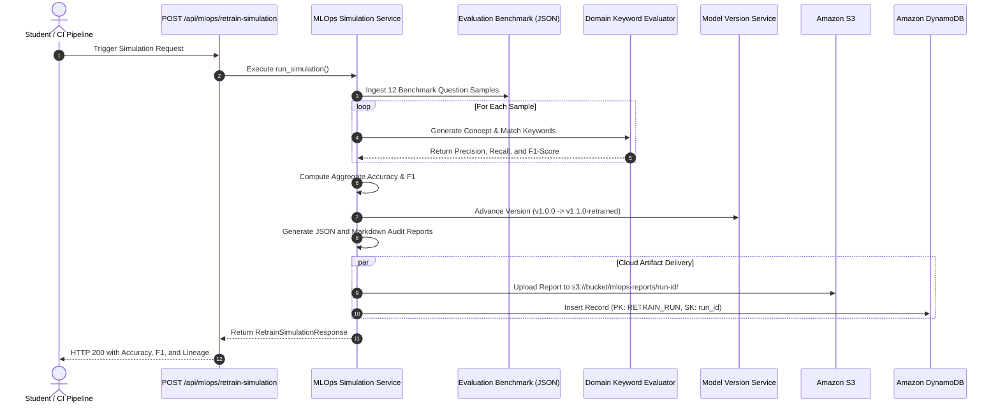

# System Architecture & Technical Design Document

**Project Title:** Serverless Chatbot with MLOps Pipeline  
**Student:** Dhanush S (Registration Number: 23MIS0224)  
**Institution:** Vellore Institute of Technology (VIT)  
**Course:** Agile Development Process and DevOps  
**Faculty Guide:** Prof. Arun Kumar  

---

## 1. Architectural Overview

The **Serverless Study Assistant** is engineered around a hybrid, decoupled architecture that supports:
1. **Local Friction-Free Mode:** Runs completely on a developer workstation using SQLite, Python Uvicorn, and local filesystem reports without requiring AWS credentials or cloud billing.
2. **AWS Cloud-Native Serverless Mode:** Leverages five managed AWS services (S3, Lambda, API Gateway, DynamoDB, and CloudWatch) to provide a resilient, auto-scaling, scale-to-zero production environment.

The system incorporates dual-engine inference (Groq/LLaMA + Rule-Based Fallback) and an automated educational MLOps continuous delivery pipeline.

---

## 2. Mermaid Architecture Diagrams

### 2.1 Complete End-to-End Cloud & Local Architecture

---

### 2.2 Chat Request Sequence Flow

---

### 2.3 Educational MLOps Retraining Simulation Workflow

---

## 3. Deep Dive: The Five AWS Services

### Service 1: Amazon Simple Storage Service (Amazon S3)
- **Role:** Immutable artifact repository and model benchmark evaluation dataset archive.
- **Bucket Configuration:** `vit-study-assistant-artifacts-23mis0224` (Region: `us-east-1`).
- **Security:** Private bucket by default with `BlockPublicAcls`, `BlockPublicPolicy`, and `ServerSideEncryption: AES256`.
- **Stored Objects:**
  - `datasets/evaluation_dataset.json`: Versioned ground-truth evaluation benchmark.
  - `mlops-reports/{run_id}/report.json`: Machine-readable evaluation metrics.
  - `mlops-reports/{run_id}/report.md`: Formatted academic evaluation summary.

### Service 2: AWS Lambda
- **Role:** Serverless compute runtime executing the FastAPI application.
- **Runtime:** Python 3.10 / Python 3.11 with 512 MB memory and 15-second timeout.
- **Execution Model:** Stateless container invocation adapted via `Mangum(app, lifespan="off")`.
- **Economics:** Scale-to-zero; zero charges incurred when the application is idle.

### Service 3: Amazon API Gateway
- **Role:** Managed API ingress providing secure HTTP endpoints to the frontend.
- **Type:** HTTP API v2 (optimized for low latency and serverless payloads).
- **Configured Routes:**
  - `GET /` -> Root metadata verification
  - `GET /api/health` -> System health & cloud configuration audit
  - `POST /api/chat` -> Student question submission and AI inference
  - `GET /api/metrics` -> Operational latency and success rates
  - `GET /api/model-version` -> Model lineage and version auditing
  - `POST /api/mlops/retrain-simulation` -> Educational MLOps pipeline trigger
- **CORS:** Configured for `*` or specific frontend origins with allowed methods `GET, POST, OPTIONS`.

### Service 4: Amazon DynamoDB
- **Role:** Managed NoSQL database for fast key-value and document persistence.
- **Table Name:** `StudyAssistantRecords`
- **Primary Key Design:**
  - **Partition Key (`PK`):** String (`CONVERSATION#{id}`, `MODEL_VERSION`, `RETRAIN_RUN`, `METRICS_SNAPSHOT`)
  - **Sort Key (`SK`):** String (`{timestamp}` or `{run_id}` or `{record_version}`)
- **Capacity Mode:** On-Demand (pay-per-request) with automated scaling.

### Service 5: Amazon CloudWatch
- **Role:** Centralized logging, operational monitoring, and alerting.
- **Components:**
  - **CloudWatch Logs:** Log Group `/aws/lambda/study-assistant-backend` aggregating Python structured logs.
  - **CloudWatch Metrics:** Real-time tracking of `Invocations`, `Duration`, `Errors`, and custom Embedded Metric Format events.
  - **CloudWatch Alarms:** Configured alarm `StudyAssistant-HighErrorRate` triggering when error rate exceeds 5% over 5 minutes.

---

## 4. Local vs. Cloud Comparison

| Characteristic | Local Development Mode | AWS Cloud-Native Mode |
|---|---|---|
| **Host Environment** | Developer PC (Windows / Linux) | AWS Lambda + API Gateway |
| **Persistence** | Embedded SQLite (`study_assistant.db`) | Amazon DynamoDB (`StudyAssistantRecords`) |
| **Artifact Storage** | Local directory (`data/reports/`) | Amazon S3 (`vit-study-assistant-artifacts`) |
| **Observability** | Console stdout & in-memory counters | Amazon CloudWatch Logs & Metrics |
| **Cost** | **$0.00 (Zero)** | **Free Tier Eligible (~$0.00)** |
| **Setup Time** | < 2 minutes via PowerShell | ~5 minutes via AWS CLI / SAM |
